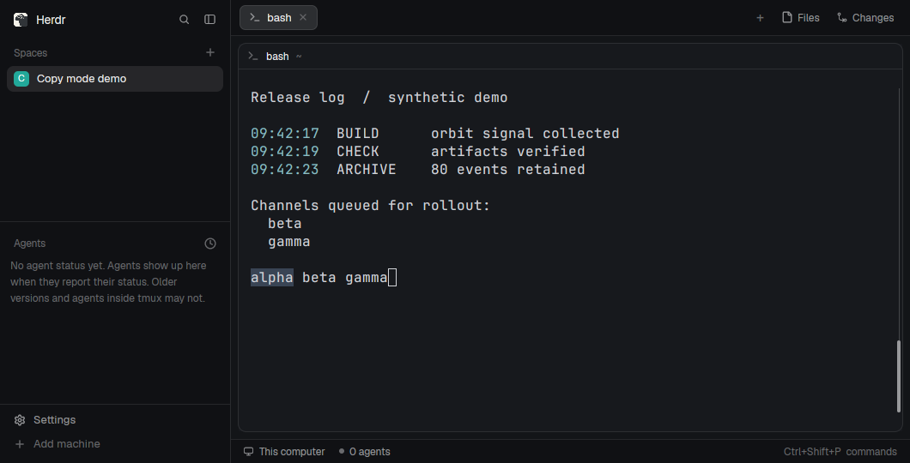

# Herdr Copy Mode

Use Vim-style keys to select and copy text directly in a Herdr Desktop terminal pane, including its scrollback. The mod never opens a second terminal or reads a text snapshot.



Requires **Herdr Desktop 0.1.16 or later**, not the Herdr TUI. Verified on Linux. No runtime dependencies beyond Herdr and its core.

## Install

1. Copy `mods/copy-mode` into `~/.config/herdr-app/mods/` (or your `HERDR_APP_HOME`).
2. Merge the `terminal` entry from [`keys.json`](keys.json) into your existing keys. The default is `Ctrl+B`, then `[`. Do not replace your entire keys file. If you already use a prefix mod, add `[` to that mod's bindings to dispatch `mod.open:copy-mode` instead.
3. Run `herdr-app check ~/.config/herdr-app/mods/copy-mode`.

The standalone binding takes `Ctrl+B [` away from programs in the focused terminal. Choose another prefix if you need that exact sequence inside tmux.

## Keys

| Key | Action |
| --- | --- |
| `Ctrl+B`, then `[` | Enter copy mode in the active terminal pane |
| `h` `j` `k` `l` or arrows | Move left, down, up or right |
| `PageUp` / `PageDown` or `Ctrl+B` / `Ctrl+F` | Move by a page |
| `0` / `$` or `Home` / `End` | Move to the beginning or end of the line |
| `g` / `G` | Move to the oldest or newest retained row |
| `v` or `Space` | Anchor characterwise selection; movement now extends it |
| `y` or `Enter` | Copy the visual selection and quit; without `v`, just quit |
| `q` or `Esc` | Quit without yanking |
| `/` | Leave copy mode and open the same pane's built-in find bar |

The pane returns to its entry scroll offset when copy mode closes, as long as the history is still retained. Search uses Herdr's native find bar: type the query, navigate with `Enter` / `Shift+Enter`, and close with `Esc`. Search does not move the copy cursor or resume a visual selection. Start copy mode again after closing find.

The native selection starts at the program cursor, or the bottom-left of the viewport if you already scrolled up. This mod is for normal terminal panes, not terminal peeks, swapped-in terminals or layout terminal blocks. It does not implement linewise visual mode (`V`), word/paragraph motions, or Vim search repeat (`n` / `N`). On Linux, Herdr may update the PRIMARY selection while moving; `y` writes the regular clipboard.

## Development

Rust defines the key policy and generates `mods/copy-mode/transitions.js`; `main.js` adapts it to Desktop's focus and terminal commands. A user installing the mod does not need to compile or run Rust.

```sh
cargo run --quiet > mods/copy-mode/transitions.js
./scripts/check
herdr-app check mods/copy-mode
```

MIT, like the companion Rust plugins. The key behavior is inspired by [Herdr TUI copy mode](https://github.com/herdrdev/herdr/blob/master/src/app/input/copy_mode.rs); the implementation here uses the Desktop API.
