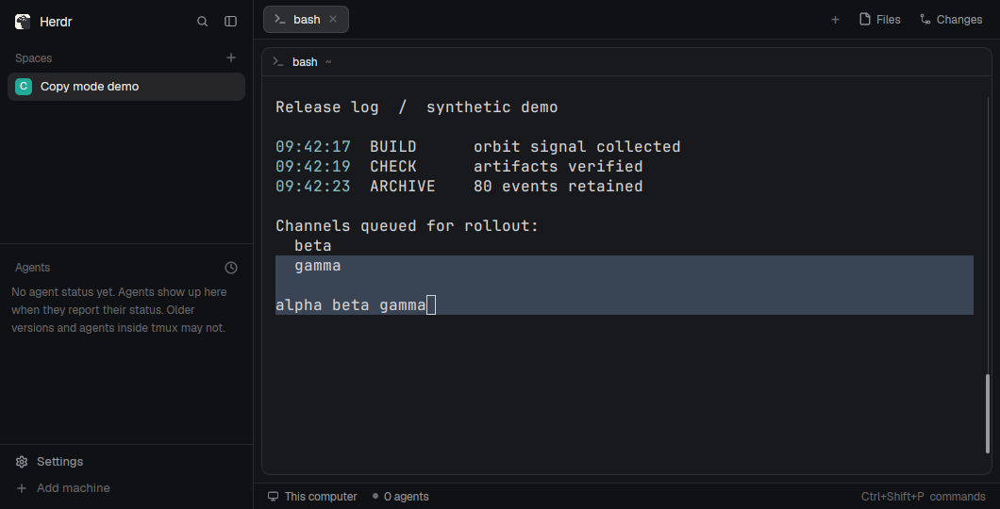

# Herdr Copy Mode

Select and yank terminal output with Vim keys in the pane where it appeared. The terminal stays visible; only its native selection changes.

## What you see

The existing Herdr window, using its own theme, fonts and pane layout. The copy cursor is a one-cell native selection. When you extend a selection, the pane highlights the range in its usual selection color. `/` shows Herdr's find bar inside the terminal. There are no widgets for agent status and no new tab or visible popup.

## How it behaves

Bind `Ctrl+B`, then `[`, in the terminal context. Start at the program cursor, or the bottom-left visible cell when the pane is already scrolled back. Move with `hjkl` or arrows; use `PageUp`/`PageDown` or `Ctrl+B`/`Ctrl+F` for pages, `Ctrl+U`/`Ctrl+D` for half pages, `0`/`^`/`$` for line positions, `g`/`G` for history boundaries, and `{`/`}` for blank rows.

`v` or `Space` anchors characterwise selection. `V` selects the entire rendered row, and row motions extend the range in either direction. `w`/`b`/`e` distinguish punctuation; `W`/`B`/`E` split only on whitespace. Both families work before and during selection and can cross rows. `y` or `Enter` yanks only in visual mode, then exits. `q` or `Esc` cancels. Leaving clears the selection and restores the entry scroll offset. `/` exits copy mode, hands focus to the native find field and lets Herdr handle the query and next/previous matches.

In visual mode, `il` selects from the first to the last non-space cell on the current line; `al` selects all cells on it. `au` selects a URL, `aa` selects the complete row or wrapped rows of an agent resume command, including a harness output label such as `Continue`. and `ii` selects rows with at least as many leading spaces as the row at the cursor. Blank rows do not break an indentation block. `i{` selects inside balanced braces and `a{` includes the braces. URLs, agent commands and braces use the object at the cursor or seek forward; `il` and `al` never seek to another line. Each object replaces the previous visual range. Nothing is copied until an explicit yank.

## Built from

- `mods/copy-mode/` is a Herdr Desktop JavaScript mod with `"place": "none"` and a `0×0` frameless popup. The popup holds a GPUI focus handle without drawing or dimming anything. It is not a terminal view.
- `keys.json` is a merge snippet, not a replacement keymap. The entry action is `mod.open:copy-mode`; a personal prefix mod can dispatch the same action on `[`.
- The Rust program in `src/main.rs` generates the checked-in transition table. No Rust binary ships with the mod. The JavaScript view uses Desktop's terminal selection, scrolling and search commands. A private `nextCommand()` acknowledgement waits for native edits before applying queued keys. Text motions and objects read a fresh bounded snapshot through `hc read` for coordinates only; the snapshot is never rendered or copied to the clipboard.
- `preview.png` is a screenshot of Herdr Desktop 0.1.16 with synthetic build output and an active keyboard selection.

## Watch out

- Require Herdr Desktop 0.1.16 or later for the terminal selection commands. Target a live model pane only. Never request history from `hc read` when that pane is on the alternate screen; this can send scroll input to the running program.
- Ghostty counts absolute display rows from the oldest retained history. The core snapshot joins soft wraps and drops trailing blank rows. Use pane width and the last row reported by Desktop to align it, and preserve a logical visual anchor independently of the native endpoint order.
- Indentation uses rendered spaces, not source tab stops; continuation rows inherit the indentation of their logical line. Trailing whitespace-only rows omitted by the snapshot cannot extend the block. Resume detection accepts simple prompts such as `$` and `user@host:~$`, not arbitrary prompt themes. The native clipboard trims trailing spaces even when the full grid row is selected. Brace matching does not parse strings or comments.
- Build multirow ranges from the lower edge upward: Ghostty's native `down` adjustment skips blank rows. Limit the range to 1,000 display rows including the anchor. Text alignment and native endpoint placement can be approximate on complex Unicode or padded cells.
- Native find doesn't expose match positions or a completion callback. Close copy mode before handing focus to find; it cannot resume the visual selection or offer `n`/`N`.
- Herdr can assign existing window shortcuts before raw key handling. Keep the person's other bindings and resolve any prefix collision. On Linux, native selections can set PRIMARY independently of clipboard yank.

## Done when

- `herdr-app check mods/copy-mode` succeeds.
- From a live synthetic terminal, press `Ctrl+B [` and move with `hjkl`. `v`, more movement and `y` copy the intended text without typing any of those keys into the program.
- On `alpha.one   beta`, `0 v w y` copies `alpha.` and `0 v W y` copies `alpha.one   b`. The visual anchor stays fixed as the motion crosses the punctuation or whitespace.
- `V` extends and contracts in both directions, including blank rows. Rapid movement followed immediately by `y` copies the final range.
- `vil y` copies the text on the current line without leading or trailing padding; `val y` copies the full display row; `vau y` copies the URL without a trailing `),`; `vaa y` copies a resume command's full row including its prompt and leading spaces; `vii y` includes a blank row between equally indented lines but not the following outdented line.
- From the live screen, move into scrollback and press `Esc`. The original viewport returns and the regular clipboard is unchanged.
- `/` opens the same pane's find bar, an existing term is highlighted, and closing find returns ordinary keyboard input to the terminal.
- The gallery preview shows a real selection in an isolated app window displaying synthetic content.
